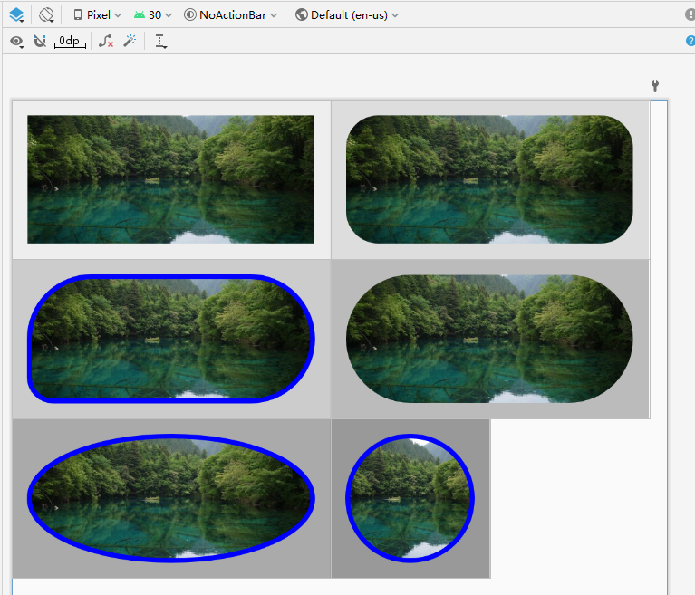

# Lightweight and fast  RoundedImageView

Completely based on ImageView, although a single draw operation may not be the fastest,
it avoids unnecessary redraws. Overall, it remains quite efficient.

New: Standard rounded corners or API 33+ will automatically enable the system's ViewOutlineProvider for optimal performance.

### [中文文档](README-zh.md)

```
        <com.wang.round.RoundedImageView
            android:id="@+id/riv"
            android:layout_width="400dp"
            android:layout_height="200dp"
            android:layout_marginTop="1px"
            android:background="#aaa"
            android:padding="20dp"
            android:scaleType="centerCrop"
            android:src="@drawable/ttt3"
            app:rivBorderColor="#f0f"
            app:rivBorderWidth="10dp"
            app:rivCornerRadius="50dp" />
```



#### All attributes:

rivCornerRadius、rivCornerTopLeftRadius、rivCornerTopRightRadius、rivCornerBottomLeftRadius、rivCornerBottomRightRadius、rivOval

rivBorderWidth、rivBorderColor

### Support

- Support rounded corners, four different rounded corners, oval, and border

- Support xml preview

- All ImageView images are supported, such as: glide load gif images

- All ImageView properties are available and are exactly the same (except setCropToPadding), such as
  adjustViewBounds、scaleType、padding

### Gradle

Your build.gradle must have jitpack.io, like：

```
allprojects {
    repositories {
        maven { url 'https://jitpack.io' }
        google()
        jcenter()
    }
}
```

then：
`api or implementation 'com.github.weimingjue:RoundedImageView:1.0.3'`

Breaking Change: Prefix all XML attributes with 'riv' for quick autocompletion and namespace isolation.